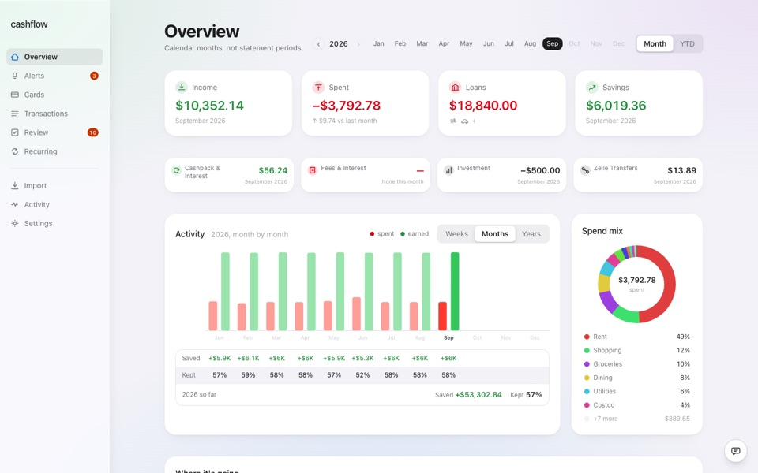
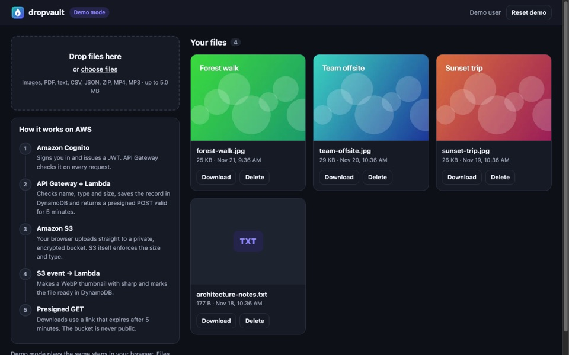
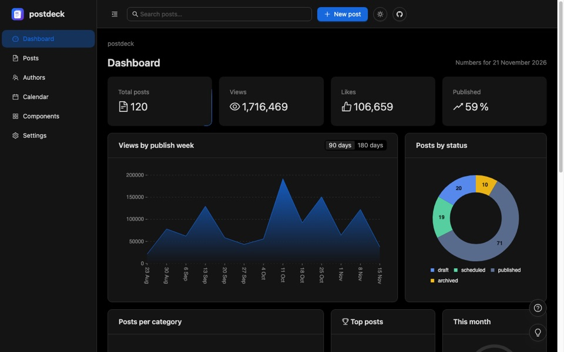
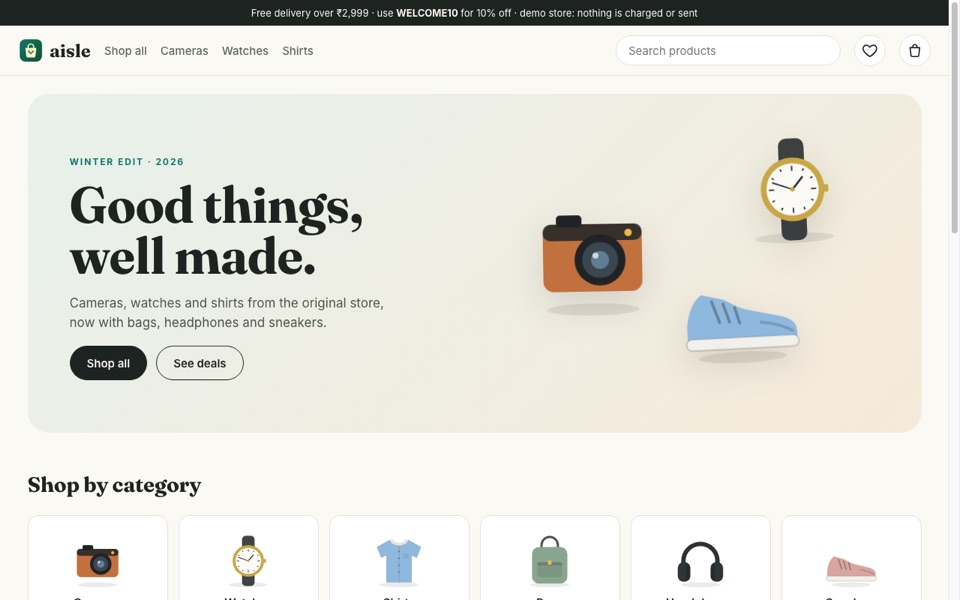
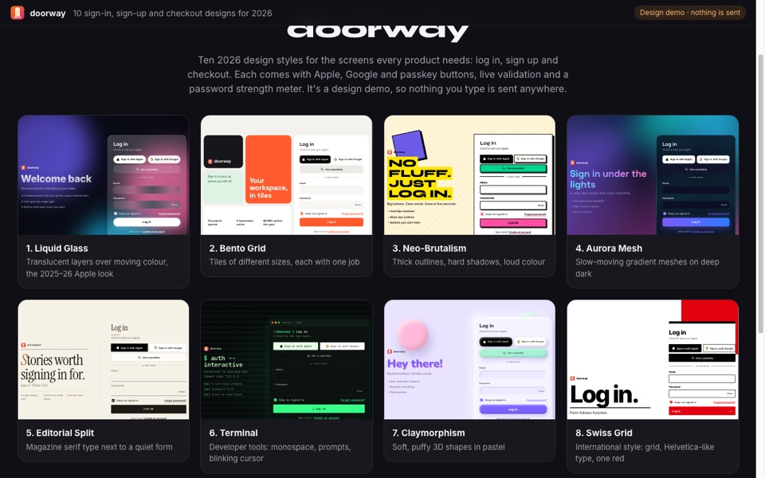
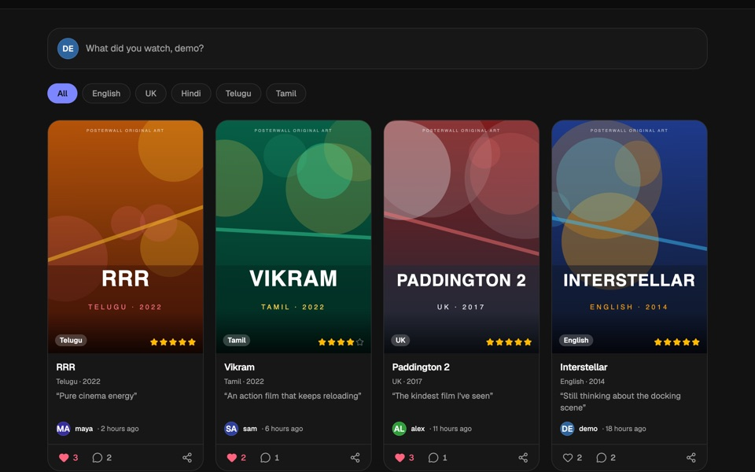
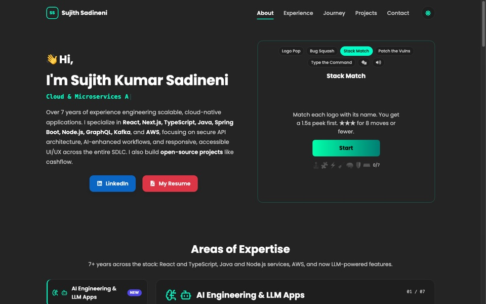
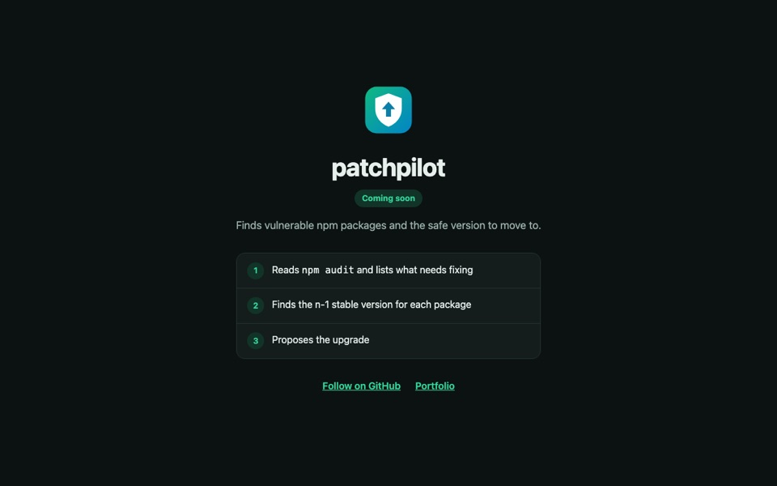

  
  
  
  

## 👨‍💻 About me

Over **7 years** of experience engineering scalable, cloud-native applications. I specialize in **React, Next.js, TypeScript, Java, Spring Boot, Node.js, GraphQL, Kafka** and **AWS**, focusing on secure API architecture, AI-enhanced workflows, and responsive, accessible UI/UX across the entire SDLC. I also build **open-source projects** like [cashflow](https://github.com/sujithsadineni/cashflow).

## 🛠️ What I work with

  

| Area | Tools |
| --- | --- |
| 🤖 AI Engineering & LLM Apps | Claude API, tool use, agent loops, Zod validation, prompt caching, Claude Code |
| 🎨 Frontend | React, Next.js, Angular, TypeScript, Redux, accessibility |
| ⚙️ Backend | Java, Spring Boot, Node.js, Express, GraphQL, REST |
| ☁️ Cloud & DevOps | AWS (ECS, EC2, S3, CloudWatch), CI/CD |
| 🐳 Containers | Docker, Kubernetes, EKS, Helm |
| ⚡ Performance & Scale | Kafka, code splitting, memoization, SQL indexing, Grafana |
| 🧪 Testing & Quality | Jest, RTL, Cypress, JUnit, Mockito, SonarQube |

## 🚀 Featured projects

Every project has a live demo. Click a picture to open it.

<table>
  <tr>
    <td width="50%" valign="top">
      
      <h3>💰 cashflow ⭐ Featured</h3>
      Household expense tracker that runs entirely on your own computer. 
      <a href="https://sujithsadineni.github.io/cashflow/">Live demo</a> · <a href="https://github.com/sujithsadineni/cashflow">Code</a>
    </td>
    <td width="50%" valign="top">
      
      <h3>☁️ aws-dropvault</h3>
      Private file uploads on AWS: straight to S3, with sign-in, thumbnails and infrastructure as code. 
      <a href="https://sujithsadineni.github.io/aws-dropvault/">Live demo</a> · <a href="https://github.com/sujithsadineni/aws-dropvault">Code</a>
    </td>
  </tr>
  <tr>
    <td valign="top">
      
      <h3>📊 postdeck</h3>
      A posts admin console built with Ant Design 6: charts, tables, forms and themes. 
      <a href="https://sujithsadineni.github.io/postdeck/">Live demo</a> · <a href="https://github.com/sujithsadineni/postdeck">Code</a>
    </td>
    <td valign="top">
      
      <h3>🛍️ aisle</h3>
      A modern storefront: filters, product options, cart with promo codes and a three-step checkout. 
      <a href="https://sujithsadineni.github.io/aisle/">Live demo</a> · <a href="https://github.com/sujithsadineni/aisle">Code</a>
    </td>
  </tr>
  <tr>
    <td valign="top">
      
      <h3>🚪 doorway</h3>
      Ten 2026 designs for log in, sign up and checkout, with Apple, Google and passkey buttons. 
      <a href="https://sujithsadineni.github.io/doorway/">Live demo</a> · <a href="https://github.com/sujithsadineni/doorway">Code</a>
    </td>
    <td valign="top">
      
      <h3>🎬 PosterWall</h3>
      Movie posters in five languages: rate, like and discuss. 
      <a href="https://sujithsadineni.github.io/posterwall/">Live demo</a> · <a href="https://github.com/sujithsadineni/posterwall">Code</a>
    </td>
  </tr>
  <tr>
    <td valign="top">
      
      <h3>✨ Portfolio Website</h3>
      React 19 and TypeScript, light and dark, five mini-games. 
      <a href="https://sujithsadineni.github.io/Portfolio/">Live demo</a> · <a href="https://github.com/sujithsadineni/Portfolio">Code</a>
    </td>
    <td valign="top">
      
      <h3>🛡️ patchpilot 🚧 In progress</h3>
      Finds vulnerable npm packages and the safe version to move to. 
      <a href="https://sujithsadineni.github.io/patchpilot/">Preview</a> · <a href="https://github.com/sujithsadineni/patchpilot">Code</a>
    </td>
  </tr>
</table>

## 📈 Journey

## 🔭 Building now

- **[cashflow](https://github.com/sujithsadineni/cashflow)**: an open-source, local-first finance app with a grounded Claude assistant.
- **[patchpilot](https://github.com/sujithsadineni/patchpilot)**: automatic vulnerability-fix and version-upgrade detection.

<a href="https://sujithsadineni.github.io/Portfolio/">sujithsadineni.github.io/Portfolio</a> · thanks for stopping by 👋

